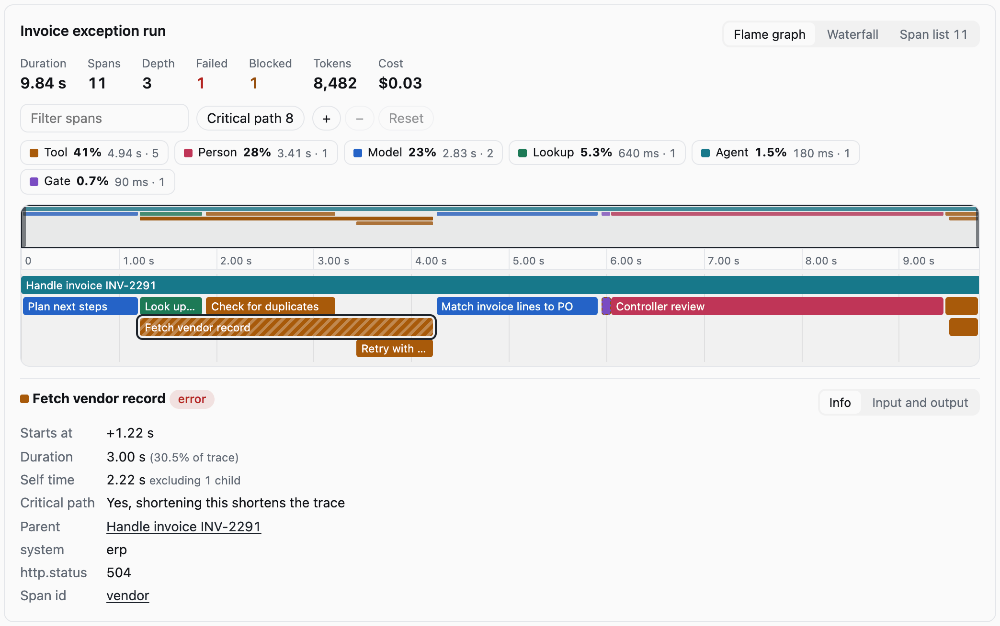
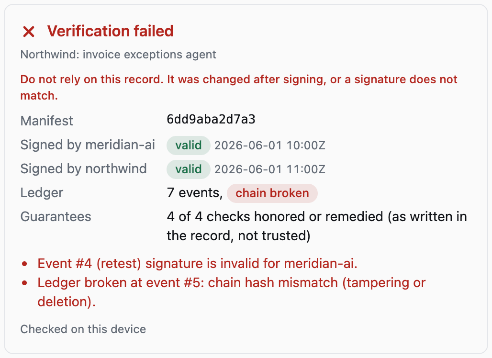
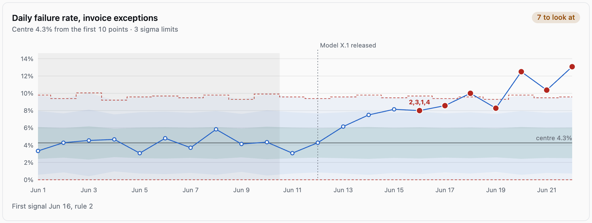
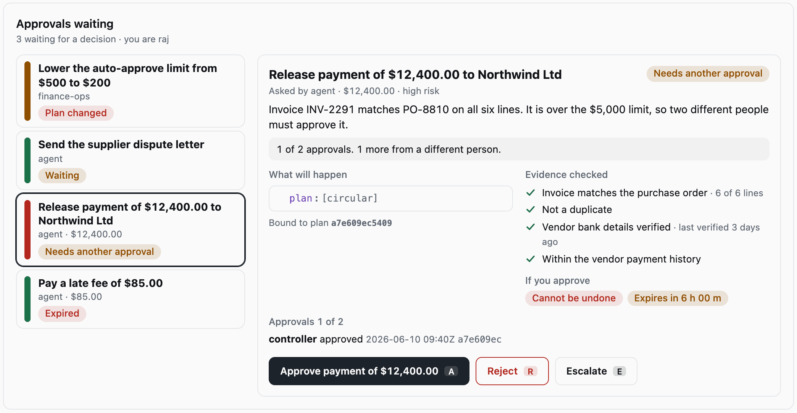
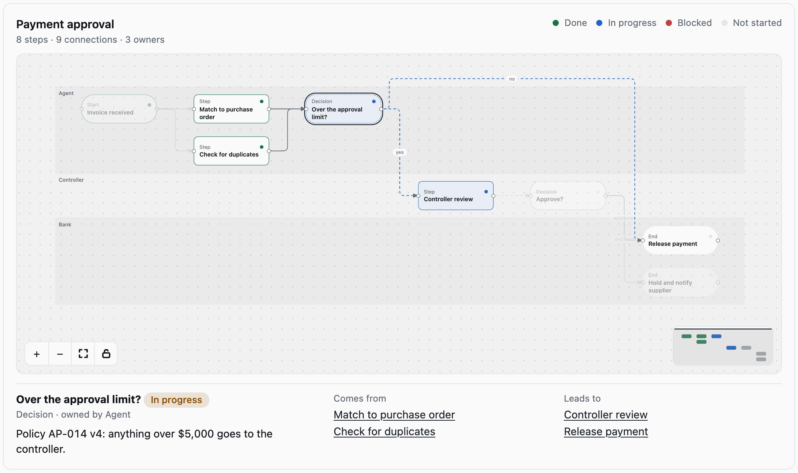

# Orlune

Components for agents that put it in writing.

React components that show what an AI agent did, who signed off, and whether the record has been tampered
with. 26 components in three sets, installable as source through a shadcn registry or as a package:

- **Workflow** (6): `Swimlane`, `Trail`, `Bottlenecks`, `Priority`, `Funnel`, `Compare`. Compact on purpose: a model fills them in, so they take plain data.
- **Record** (7): `VerifyStatus`, `LedgerTimeline`, `GuaranteeCard`, `RetestClock`, `ConfidenceBar`, `ApprovalGate`, `ChainGraph`.
- **Complex** (13), for data from your own systems: `TraceExplorer`, `DiffViewer`, `FlowCanvas`, `DataGrid`, `ControlChart`, `Sankey`, `ApprovalQueue`, `DeadlineGantt`, `ActivityHeatmap`, `EvalMatrix`, `FleetBoard`, `ReceiptCard`, `JsonTree`.

Plus a small offline verifier (`orlune/verify`) and an optional [OpenUI](https://github.com/thesysdev/openui)
binding (`orlune/openui`).

> Status: v0. The shadcn install below works today. The npm package ships with the first release. APIs may change before 1.0.

## Quick start

```bash
npx shadcn@latest add falnor-io/orlune/approval-queue
```

```tsx
import { ApprovalQueue } from '@/components/orlune/ApprovalQueue'
import '@/components/orlune/styles.css'

<ApprovalQueue title="Approvals waiting" items={items} reviewer="raj" onDecide={save} />
```

Each item carries the exact plan, the evidence checked, how many different people must approve, and when it expires.
Approvals are bound to a hash of the plan, so editing the plan makes earlier approvals stale.
Props for every component are in [`docs/COMPONENTS.md`](docs/COMPONENTS.md).

**Reference:** every component in light and dark is in [`docs/index.html`](docs/index.html) (open it locally;
it is a static page), with what each was inspired by in [`docs/REFERENCES.md`](docs/REFERENCES.md). Regenerate it with `npm run gallery`.



| Tampered record | Control chart |
| --- | --- |
|  |  |





## Why

Most generative UI libraries give a model a box of charts and let it say anything. Orlune is built around
one rule: **the model fills in data, the interface computes everything derived, and verification state never
comes from a model.**

- `Funnel` works out the share kept at each step. `Trail` adds up the waits. `ConfidenceBar` computes an
  exact interval from `passes` and `n`. None of these figures are in any schema, so a model cannot make one up.
- `VerifyStatus` renders only a result from `verifyRecord`. With no result it says "Not verified", never a pass.
- In the OpenUI binding, `VerifyStatus`, `LedgerTimeline` and `GuaranteeCard` take no verification data from the
  model: they read the verifier's result from `RecordProvider`.
- `RetestClock` and `ApprovalGate` are not exposed to models at all. Their state is a fact about the world, so
  your code passes it in.
- Anything that fails its schema renders nothing.

## Install

### As source, through the shadcn registry (recommended)

Files are copied into `components/orlune/`, so you own and can edit them. Install any item straight from
the repository, and dependencies come with it:

```bash
npx shadcn@latest add falnor-io/orlune/swimlane falnor-io/orlune/eval-matrix
npx shadcn@latest add falnor-io/orlune/all        # everything except the OpenUI binding
npx shadcn@latest list falnor-io/orlune           # see every item
```

To use the short `@orlune/...` names instead, add the namespace once:
`npx shadcn@latest registry add @orlune=https://raw.githubusercontent.com/falnor-io/orlune/main/r/{name}.json`

Or install one item straight from its URL, for example
`npx shadcn@latest add https://raw.githubusercontent.com/falnor-io/orlune/main/r/agent-trace.json`.
Then import the stylesheet once: `import '@/components/orlune/styles.css'`.

Items: `core` (always pulled in), `verify`, `record-context`, the 26 components in kebab-case (`swimlane`,
`verify-status`, `trace-explorer`, and so on), `openui`, and `all`. The registry is tested by installing it
into a clean project and type-checking the result.

### As a package

```bash
npm install orlune zod react
```

```tsx
import 'orlune/styles.css'
import { Funnel, VerifyStatus, LedgerTimeline, RecordProvider } from 'orlune'
import { verifyRecord } from 'orlune/verify'

const result = await verifyRecord(record) // record = manifest + signatures + ledger + public keys

<RecordProvider result={result} manifest={record.manifest}>
  <VerifyStatus />
  <LedgerTimeline />
</RecordProvider>

<Funnel title="How many make it through" unit="deals" steps={[
  { label: 'Signed', value: 40 },
  { label: 'Set up', value: 31 },
]} />
```

### Next.js and server components

Every component that uses state, effects or event handlers starts with `'use client'`, so you can import any of them
from a server component. The rest render on the server. CI builds a Next.js App Router page against the packed
package (`npm run smoke:next`), including a record verified on the server.

`zod` is a peer dependency because the prop types are inferred from the schemas the OpenUI binding uses.

### Theming

Plain CSS, no Tailwind. Components read `--background`, `--foreground`, `--muted-foreground`, `--border` and
`--primary` when present, so a shadcn theme applies as is. Override any `--ol-*` variable to change it.

### With OpenUI

```ts
import { buildOrluneLibrary } from 'orlune/openui'
const library = buildOrluneLibrary() // pass to <Renderer library={library} />
// or merge with your own: createLibrary({ root, components: [...mine, ...orluneComponents()] })
```

`@openuidev/react-lang` is an optional peer dependency, needed only for this entry point.

A model can place the workflow components and fill in plain data. The record views (`VerifyStatus`,
`LedgerTimeline`, `GuaranteeCard`) read the verifier's result from `RecordProvider`, so a model cannot write what
they say. The explorers (`TraceExplorer`, `FlowCanvas`, `ControlChart`, `Sankey`, `ActivityHeatmap`, `DeadlineGantt`,
`EvalMatrix`, `DiffViewer`, `FleetBoard`) take a source id. You hand over your data once, the model chooses which of
it to show:

```tsx
import { SourcesProvider, describeSources } from 'orlune'

const sources = { traces: { 'run-42': spans }, sankeys: { intake: { nodes, links } } }
const prompt = library.prompt({ additionalRules: describeSources(sources) }) // tells the model which ids exist

<SourcesProvider sources={sources}>
  <Renderer response={reply} library={library} isStreaming={streaming} />
</SourcesProvider>
// the model writes: root = Reply([TraceExplorer("run-42", "Why this run was slow")])
```

An id you did not provide renders a short note, never data.

### Complex components take your data, not a model's

The complex components show facts from your systems (traces, eval runs, fleet state, deadlines, signed events).
A model can place them through OpenUI by source id, but it cannot supply the data, so it cannot invent evidence.
`ApprovalQueue` and `ReceiptCard` are not in the OpenUI set, because a decision or a receipt is a fact your code reports.

- `TraceExplorer`: self time, share of trace, critical path, totals and cost are computed from the spans. Parallel calls get their own rows. Orphans and parent cycles are shown as roots, never dropped.
- `ApprovalQueue`: an approval is bound to the exact plan by hash, so editing the plan makes earlier approvals stale. A second approval must come from a different person, the requester cannot approve their own request, and anything undecided expires.
- `ControlChart`: a p-chart with per-point limits and the Western Electric run rules. A signal means "look closer", and a quiet chart is never called safe.
- `EvalMatrix`: one flipped case is "possible drift"; a regression needs the exact paired test (McNemar).
- `Sankey`: cases that entered a node and did not leave it are called out.
- `DataGrid`: draws only visible rows, so thousands are fine. CSV export neutralises cells that start with `=`, `+`, `-` or `@`.
- `FlowCanvas`, `DiffViewer`, `DeadlineGantt`, `ActivityHeatmap`, `FleetBoard`, `JsonTree`: see the reference page.

## The record format

The verifier reads a bundle of four parts, all plain JSON:

| Part | What it proves |
| --- | --- |
| `manifest` | The guarantees as data: statement, check, deadline, remedy. Hashed with canonical JSON (sorted keys). |
| `signatures` | Each party's Ed25519 signature over the manifest hash. Both must sign. |
| `ledger` | Append-only events. Each carries the hash of the one before it and its own signature. |
| `publicKeys` | One PEM (SPKI) per party. |

`verifyRecord` checks the manifest hash, every signature, the hash chain, and the deadline rules, using Web
Crypto only. No network. A breach counts as honored only when a matching `remedy` event exists. Pass
`{ now }` to judge open deadlines at a fixed time.

Built-in guarantee rules are keyed by id: `G1-CRITERIA`, `G2-RETEST-48H`, `G3-ROOTCAUSE-24H`,
`G4-RECORD-OWNED`. Other ids are listed in the manifest but not judged yet.

## Try it

```bash
npm install
npm run sample      # writes a signed sample record
npm run check       # typecheck and the test suite, including the registry
npm run demo        # the live gallery (build with demo:build, serve with: npx vite preview demo)
npm run registry    # rebuild registry.json and r/*.json from src/
npm run gallery     # recapture screenshots (needs the demo served on :5198) and rebuild docs/index.html
```

## Quality gates

`npm run check` runs lint, types and the tests. The pre-commit hook runs lint and types; CI runs everything and fails if the registry is out of date. Lint rules each have a test that feeds them a bad case.

| Gate | What it stops |
| --- | --- |
| Style | Tracked uppercase captions, gradients, glows, shadows on resting surfaces, glass, text under 11px, monospace outside ids and code |
| Contrast | Colour tokens checked in both themes, with host variables treated as absent: text, status pills, labels on bars |
| Copy | Stock marketing words, em dashes, emoji and symbol glyphs, placeholder names, generic button labels, and components that carry too much prose (60 words of static text each) |
| Accessibility | Buttons, inputs, images and SVGs without a name or alt text |
| Project | Classes used but not defined, dead CSS, two components sharing a class, filenames that differ only by case, exported components with no demo or screenshot |
| Registry | Any import in an installable file that the install would not bring along |

`npm run lint:visual` renders the demo in a real browser at desktop and phone width and fails on text hugging the screen edge, clipped content and similar. It needs the [taste skill](https://github.com/leonxlnx/taste-skill) (`npx skills add leonxlnx/taste-skill`) and Chrome, and skips without them.

A line can opt out of one rule with `lint-allow(rule): reason` on it or the line above.

## What it does not claim

- Passing verification shows the record is intact and the deadlines in it were met. It does not show the
  agent is correct. `ConfidenceBar` exists to keep that distinction visible: 50 cases never prove 90%.
- A zero-failure count is a bound, not a guarantee, and the component says so.

## License

MIT. Built by [Falnor](https://falnor.io).
