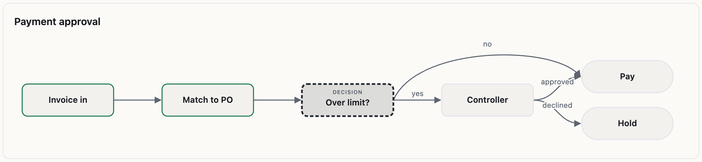
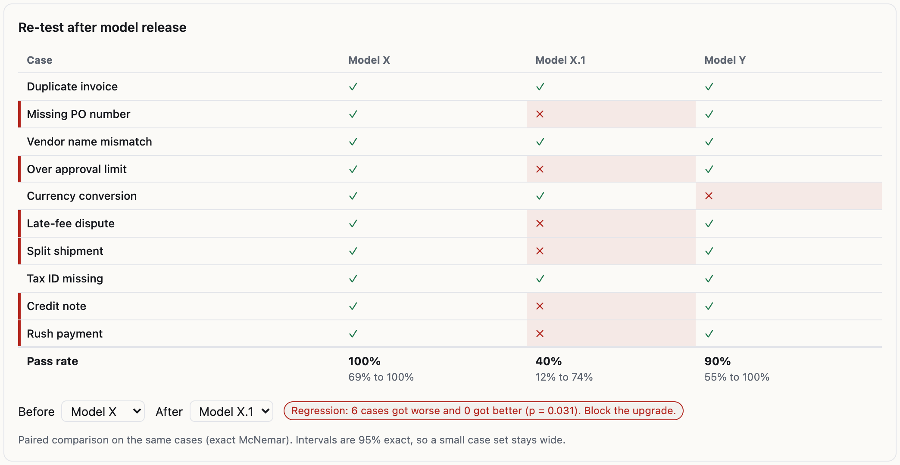

# incised

Components for agents that put it in writing.

React components that show what an AI agent did, who signed off, and whether the record has been tampered
with. 19 components in three sets, installable as source through a shadcn registry or as a package:

- **Workflow** (6): `Swimlane`, `Trail`, `Bottlenecks`, `Priority`, `Funnel`, `Compare`.
- **Record** (6): `VerifyStatus`, `LedgerTimeline`, `GuaranteeCard`, `RetestClock`, `ConfidenceBar`, `ApprovalGate`.
- **Complex** (7): `AgentTrace`, `EvalMatrix`, `FleetBoard`, `EvidenceDiff`, `ApprovalFlow`, `ChainGraph`, `ReceiptCard`.

Plus a small offline verifier (`incised/verify`) and an optional [OpenUI](https://github.com/thesysdev/openui)
binding (`incised/openui`).

> Status: v0. Not published to npm yet. APIs may change.

**Reference:** every component in light and dark is in [`docs/index.html`](docs/index.html) (open it locally;
it is a static page). Regenerate it with `npm run gallery`.

| Tampered record | Approval flow |
| --- | --- |
|  |  |



## Why

Most generative UI libraries give a model a box of charts and let it say anything. Incised is built around
one rule: **the model fills in data, the interface computes everything derived, and verification state never
comes from a model.**

- `Funnel` works out the share kept at each step. `Trail` adds up the waits. `ConfidenceBar` computes an
  exact interval from `passes` and `n`. None of these figures are in any schema, so a model cannot make one up.
- `VerifyStatus` renders only a result from `verifyRecord`. With no result it says "Not verified", never a pass.
- In the OpenUI binding, `VerifyStatus`, `LedgerTimeline` and `GuaranteeCard` take no verification data from the
  model: they read the verifier's result from `RecordProvider`.
- `RetestClock` and `ApprovalGate` are not exposed to models at all. Their state is a fact about the world, so
  your code passes it in.
- Anything that fails its schema renders nothing.

## Install

### As source, through the shadcn registry (recommended)

Files are copied into `components/incised/`, so you own and can edit them. Add the namespace once, then
install what you need:

```bash
npx shadcn@latest registry add @incised=https://raw.githubusercontent.com/falnor-io/incised/main/r/{name}.json
npx shadcn@latest add @incised/swimlane @incised/eval-matrix     # any items; dependencies come with them
npx shadcn@latest add @incised/all                               # everything except the OpenUI binding
```

Or install one item straight from its URL, for example
`npx shadcn@latest add https://raw.githubusercontent.com/falnor-io/incised/main/r/agent-trace.json`.
Then import the stylesheet once: `import '@/components/incised/styles.css'`.

Items: `core` (always pulled in), `verify`, `record-context`, the 19 components in kebab-case (`swimlane`,
`verify-status`, `agent-trace`, and so on), `openui`, and `all`. The registry is tested by installing it
into a clean project and type-checking the result.

### As a package

```bash
npm install incised zod react
```

```tsx
import 'incised/styles.css'
import { Funnel, VerifyStatus, LedgerTimeline, RecordProvider } from 'incised'
import { verifyRecord } from 'incised/verify'

const result = await verifyRecord(record) // record = manifest + signatures + ledger + public keys

<RecordProvider result={result} manifest={record.manifest}>
  <VerifyStatus />
  <LedgerTimeline />
</RecordProvider>

<Funnel title="How many make it through" unit="deals" steps={[
  { label: 'Signed', value: 40 },
  { label: 'Set up', value: 31 },
]} />
```

### Theming

Plain CSS, no Tailwind. Components read `--background`, `--foreground`, `--muted-foreground`, `--border` and
`--primary` when present, so a shadcn theme applies as is. Override any `--ic-*` variable to change it.

### With OpenUI

```ts
import { buildIncisedLibrary } from 'incised/openui'
const library = buildIncisedLibrary() // pass to <Renderer library={library} />
// or merge with your own: createLibrary({ root, components: [...mine, ...incisedComponents()] })
```

`@openuidev/react-lang` is an optional peer dependency, needed only for this entry point.

### Complex components take your data, not a model's

`AgentTrace`, `EvalMatrix`, `FleetBoard`, `EvidenceDiff`, `ApprovalFlow`, `ChainGraph` and `ReceiptCard` show
facts from your systems (traces, eval runs, fleet state, signed events). They are not in the OpenUI set, so a
model cannot place them with invented data. Their zod schemas are exported for validating what you pass in.

- `EvalMatrix` reports one flipped case as "possible drift", and calls a regression only when the exact
  paired test (McNemar) says so.
- `AgentTrace` never drops a span: orphans and parent cycles are shown as roots.
- `ApprovalFlow` lays itself out in columns; edges that skip a column arc over the top.

## The record format

The verifier reads a bundle of four parts, all plain JSON:

| Part | What it proves |
| --- | --- |
| `manifest` | The guarantees as data: statement, check, deadline, remedy. Hashed with canonical JSON (sorted keys). |
| `signatures` | Each party's Ed25519 signature over the manifest hash. Both must sign. |
| `ledger` | Append-only events. Each carries the hash of the one before it and its own signature. |
| `publicKeys` | One PEM (SPKI) per party. |

`verifyRecord` checks the manifest hash, every signature, the hash chain, and the deadline rules, using Web
Crypto only. No network. A breach counts as honored only when a matching `remedy` event exists. Pass
`{ now }` to judge open deadlines at a fixed time.

Built-in guarantee rules are keyed by id: `G1-CRITERIA`, `G2-RETEST-48H`, `G3-ROOTCAUSE-24H`,
`G4-RECORD-OWNED`. Other ids are listed in the manifest but not judged yet.

## Try it

```bash
npm install
npm run sample      # writes a signed sample record
npm run check       # typecheck and 48 tests, including the registry
npm run demo        # the live gallery (build with demo:build, serve with: npx vite preview demo)
npm run registry    # rebuild registry.json and r/*.json from src/
npm run gallery     # recapture screenshots (needs the demo served on :5198) and rebuild docs/index.html
```

## What it does not claim

- Passing verification shows the record is intact and the deadlines in it were met. It does not show the
  agent is correct. `ConfidenceBar` exists to keep that distinction visible: 50 cases never prove 90%.
- A zero-failure count is a bound, not a guarantee, and the component says so.

## License

MIT. Built by [Falnor](https://falnor.io).
